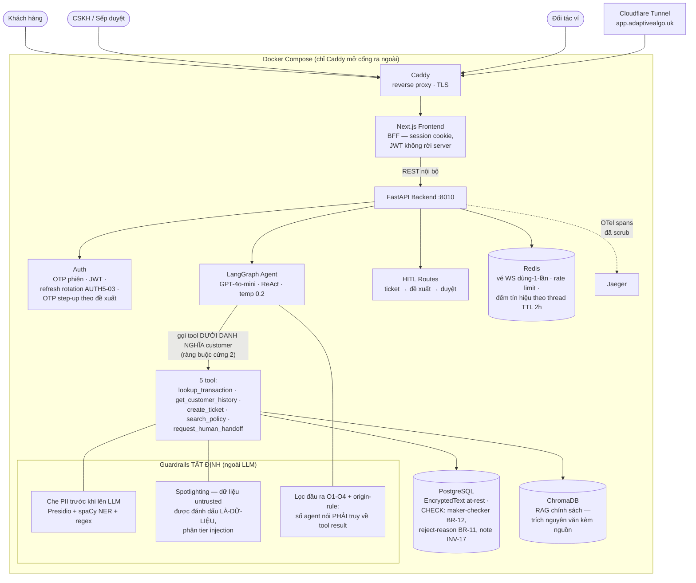

# Architecture — FIN-05

## System Overview

FIN-05 là AI Agent CSKH ví điện tử theo kiến trúc **3 lớp + guardrails tất định**: Next.js
(BFF pattern — trình duyệt không bao giờ cầm JWT backend) → FastAPI → LangGraph agent gọi 5 tool
tra cứu vào PostgreSQL thật. Nguyên tắc xuyên suốt: **AI điều tra — con người quyết định — mọi
con số có vết**. Mọi lớp an toàn (che PII, chặn bịa số, chống injection, maker-checker) là **luật
tất định ngoài LLM**, phần lớn được ép ở tầng database bằng CHECK constraint, và toàn bộ cấu trúc
được canh bởi `tests/test_invariants.py` — bộ test introspect app đang chạy thật và so với
`contracts/` (nguồn sự thật), đỏ là build hỏng.

## Architecture Diagram



## Data Flow — hai luồng chính

### 1. Lượt chat khiếu nại (đường AI)

```
Khách gõ → BFF (cookie → JWT) → FastAPI → scrub PII → LangGraph agent
  → tool (danh nghĩa customer, mask theo BR-06) → Postgres
  → reply → lọc đầu ra O1-O4 + origin-rule (số không truy được về tool result thì chặn)
  → envelope (kèm tool_calls, tin_hieu, goi_y_handoff) → BFF → khách
Mỗi bước tool ghi investigation_logs → tool_result_id → truy vết được toàn chuỗi
```

### 2. Vòng đời HITL (đường con người — AI không có mặt ở khâu quyết)

```
Agent/khách tạo ticket → hàng chờ CSKH (điều tra, KHÔNG duyệt được — authority-matrix)
  → CSKH trình đề xuất (propose_resolution, cited_tool_result_ids bắt buộc)
  → Sếp mở CHI TIẾT, đọc investigation trail → duyệt/từ chối + OTP step-up gắn đúng đề xuất
  → CHECK constraint tầng DB: người tạo ≠ người duyệt (BR-12) — SQL tay cũng không lách
  → từ chối bắt buộc kèm lý do có cấu trúc (BR-11) + note đã scrub (INV-17)
```

## Các quyết định kiến trúc then chốt (chi tiết: `docs/DECISIONS.md`, 25 ADR)

| Quyết định | Vì sao |
|---|---|
| Contracts-first: `contracts/` là nguồn sự thật, test bất biến introspect app thật | Đổi route/guard/tool mà quên cập nhật contract → đỏ ngay, không ai phải nhớ |
| AI gọi tool dưới danh nghĩa customer, không có role riêng | AI không thể vượt cấp — escalate chỉ qua tầng service (FS-06) hoặc CSKH |
| BFF pattern: JWT sống ở server Next.js, browser chỉ có session cookie | Thu hẹp bề mặt XSS/token-theft |
| Guardrails tất định thay vì "nhờ LLM tự kiểm" | Test được, giải thích được, không nhiễu; LLM sai thì lưới ngoài vẫn chặn |
| Tín hiệu cảm xúc ES-xx vào envelope, KHÔNG vào prompt (ADR-022) | Agent không phát biểu kết luận tâm lý về khách; sai thì rẻ (khách bỏ qua nút) |
| Mã hoá at-rest (Fernet) cho lời khai khách, che-lúc-xuất thay vì che-lúc-ghi (ADR-025) | Lời khai là bằng chứng tranh chấp — hệ thống tự sửa chữ là mất giá trị chứng cứ |
| Refresh token dùng-một-lần + reuse-detection thu hồi family (AUTH5-03) | Chống trộm token; đang bổ sung observability + single-flight (điều tra 16/08) |

## Tech Stack

| Layer | Công nghệ |
|---|---|
| LLM | OpenAI GPT-4o-mini (temperature 0.2) · embeddings `text-embedding-3-small` |
| Agent | LangGraph + LangChain (ReAct, 5 tool, MemorySaver theo thread) |
| Backend | FastAPI + Uvicorn · SQLAlchemy · Alembic |
| Frontend | Next.js 14 (App Router, BFF) · WebSocket live-chat |
| Data | PostgreSQL (prod) / SQLite (dev-nhanh) · Redis (fakeredis cho CI) · ChromaDB |
| An toàn | Presidio + spaCy NER · bộ lọc O1-O4 tự viết · argon2 password · Fernet field-encryption |
| Observability | OpenTelemetry (GenAI semantic conventions) + Jaeger · structured JSON logs |
| Deploy | Docker multi-stage · Caddy · Cloudflare Tunnel (home-server, 0đ/tháng) |
| CI | GitHub Actions: invariants · contract-drift · lint+test · appsec · security-findings-gate |
