# Architecture — FIN-05

> *[Bản tiếng Việt của tài liệu này không tồn tại riêng — nội dung gốc đã được dịch trực tiếp vào
> đây.]*

## System Overview

FIN-05 is an AI agent for e-wallet customer support, built on a **3-layer architecture plus
deterministic guardrails**: Next.js (BFF pattern — the browser never holds the backend's JWT) →
FastAPI → a LangGraph agent calling 5 tools that query a real PostgreSQL database. The principle
running through all of it: **the AI investigates — a human decides — every figure is traceable**.
Every safety layer (PII masking, anti-fabrication, injection resistance, maker-checker
separation) is a **deterministic rule outside the LLM**, mostly enforced at the database layer by
a CHECK constraint, and the whole structure is guarded by `tests/test_invariants.py` — a test
suite that introspects the real running app and compares it against `contracts/` (the source of
truth); red means the build is broken.

## Architecture Diagram

```mermaid
graph TB
    KH([Customer]) --> CADDY
    NV([Support agent / Supervisor]) --> CADDY
    PA([Wallet partner]) --> CADDY
    CF[Cloudflare Tunnel<br/>app.adaptivealgo.uk] --> CADDY

    subgraph Docker["Docker Compose (only Caddy exposes a port externally)"]
        CADDY[Caddy<br/>reverse proxy · TLS] --> FE[Next.js Frontend<br/>BFF — session cookie,<br/>JWT never leaves the server]
        FE -->|internal REST| BE[FastAPI Backend :8010]

        BE --> AUTH[Auth<br/>session OTP · JWT ·<br/>refresh rotation AUTH5-03 ·<br/>per-proposal step-up OTP]
        BE --> AGENT[LangGraph Agent<br/>pool of 4 rotating models · ReAct · temp 0.2]
        BE --> HITL[HITL Routes<br/>ticket → proposal → approval]

        AGENT -->|"calls tools UNDER THE CUSTOMER'S IDENTITY<br/>(hard constraint 2)"| TOOLS[5 tools:<br/>lookup_transaction · get_customer_history ·<br/>create_ticket · search_policy ·<br/>request_human_handoff]

        subgraph GUARD["DETERMINISTIC Guardrails (outside the LLM)"]
            G1[PII masked before reaching the LLM<br/>Presidio + spaCy NER + regex]
            G2[Spotlighting — untrusted data is<br/>tagged AS-DATA,<br/>injection trust-tiering]
            G3[Output filters O1-O4 + origin-rule:<br/>every figure the agent states MUST trace to a tool result]
        end
        TOOLS --- G1
        TOOLS --- G2
        AGENT --- G3

        TOOLS --> PG[(PostgreSQL<br/>EncryptedText at rest ·<br/>CHECK: maker-checker BR-12,<br/>reject-reason BR-11, note INV-17)]
        TOOLS --> RAG[(ChromaDB<br/>policy RAG —<br/>verbatim excerpt with a source citation)]
        BE --> REDIS[(Redis<br/>single-use WS tickets · rate limiting ·<br/>per-thread signal counting, 2h TTL)]
        BE -.->|OTel spans<br/>already scrubbed| JAEGER[Jaeger]
    end
```



## Data Flow — the two main paths

### 1. A complaint-chat turn (the AI path)

```
Customer types → BFF (cookie → JWT) → FastAPI → PII scrub → LangGraph agent
  → tool call (under the customer's identity, masked per BR-06) → Postgres
  → reply → output filters O1-O4 + origin-rule (a figure that can't be traced to a tool result is blocked)
  → envelope (with tool_calls, signals, a handoff suggestion) → BFF → customer
Every tool step is logged to investigation_logs → tool_result_id → the whole chain is traceable
```

### 2. The HITL lifecycle (the human path — the AI has no presence in the decision step)

```
Agent/customer creates a ticket → the support queue (investigate, CANNOT approve — authority-matrix)
  → a support agent submits a proposal (propose_resolution, cited_tool_result_ids required)
  → the supervisor opens the DETAIL view, reads the investigation trail → approves/rejects + step-up OTP bound to that exact proposal
  → a DB-layer CHECK constraint: the proposer ≠ the approver (BR-12) — not even a raw SQL write can route around it
  → a rejection requires a structured reason (BR-11) + a scrubbed note (INV-17)
```

## Key architectural decisions (details: `docs/DECISIONS.md`, 64 ADRs)

| Decision | Why |
|---|---|
| Contracts-first: `contracts/` is the source of truth, with an invariant test that introspects the real app | Changing a route/guard/tool and forgetting to update the contract turns red immediately — no one has to remember to check |
| The AI calls tools under the customer's identity, with no role of its own | The AI cannot escalate its own privileges — escalation only happens through the service layer (FS-06) or a support agent |
| BFF pattern: the JWT lives on the Next.js server, the browser only holds a session cookie | Narrows the XSS/token-theft attack surface |
| Deterministic guardrails instead of "ask the LLM to police itself" | Testable, explainable, no added noise; if the LLM gets it wrong, the outer net still catches it |
| Emotion signals (ES-xx) go into the envelope, NEVER into the prompt (ADR-022) | The agent never states a psychological conclusion about the customer; a wrong signal is cheap to recover from (the customer just ignores a button) |
| At-rest encryption (Fernet) for the customer's own statement, masked at display time rather than at write time (ADR-025) | A customer's statement is dispute evidence — a system that silently "corrects" it destroys its evidentiary value |
| A use-once refresh token + reuse-detection that revokes the whole token family (AUTH5-03) | Defends against token theft; observability + a single-flight lock were added later (see the Aug 16 investigation) |

## Tech Stack

| Layer | Technology |
|---|---|
| LLM (chat) | **A pool of 4 models, rotated automatically by the infrastructure** (ADR-043) — `qwen3.7-plus-2026-05-26` · `deepseek-v4-pro-0813` · `deepseek-v4-flash-0731` · `deepseek-v3.2`, via DashScope. 🔴 **Names are PINNED with a date — a drifting alias is REJECTED at startup** (ADR-043). `temperature=0.2`. Rotates ONLY on a quota-exhausted error class; a `429` does NOT trigger rotation. |
| LLM (embedding) | `text-embedding-3-small` via **OpenAI** — [measured] `EMBEDDING_BASE_URL=None`. **Two different providers for chat and embedding**, deliberately separated so one running out of quota doesn't drag the other down with it. |
| Agent | LangGraph + LangChain (ReAct, 5 tools). Checkpointing: **`PostgresSaver`** with its own connection pool (ADR-014) — state lives outside the process so it can scale horizontally. `MemorySaver` is **only** a fallback branch when `DB_KIND != postgresql` (tests/SQLite); `graph.py` logs a warning: *"seeing this line in production is a bug"*. |
| Backend | FastAPI + Uvicorn · SQLAlchemy · Alembic |
| Frontend | Next.js 16 (App Router, BFF) · WebSocket live chat |
| Data | PostgreSQL (prod) / SQLite (fast local dev) · Redis (fakeredis for CI) · ChromaDB |
| Security | Presidio + spaCy NER · a hand-written O1-O4 filter · argon2 passwords · Fernet field-level encryption |
| Observability | OpenTelemetry (GenAI semantic conventions) + Jaeger · structured JSON logs |
| Deploy | Multi-stage Docker · Caddy · Cloudflare Tunnel (a home server, $0/month) |
| CI | GitHub Actions: invariants · contract-drift · lint+test · appsec · security-findings-gate |
