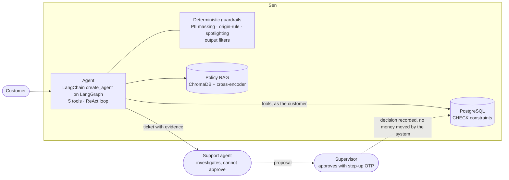

# Sen — an AI customer-service agent for e-wallets

**Sen investigates transaction disputes but never decides on money.** It looks up the real transaction, classifies the complaint and drafts an evidence-backed proposal. A support agent verifies it. Only a supervisor can approve it.

[Live demo](https://app.adaptivealgo.uk/) · [Architecture](ARCHITECTURE.md) · [Case study](CASE-STUDY.md) · [Decisions summary](docs/DECISIONS-SUMMARY.md) · [Quality report](docs/QUALITY-REPORT.md) · [Evidence from real runs](eval/EVAL-EVIDENCE.md) · [Tiếng Việt](README.vi.md)

---

## English summary

E-wallet support teams handle disputes such as "I sent money to the wrong person", "I was charged twice" or "my refund never arrived". The work is repetitive to investigate, but every answer touches someone's money.

Sen takes the investigation part. A customer chats with the agent. The agent calls five tools against a real database (transaction lookup, customer history, ticket creation, policy search, human handoff), asks only for what is missing, and creates a ticket with the evidence attached. It cannot approve, refund, adjust a balance or lock a wallet. The system has no code path that does any of these things.

The rule that shaped the whole design is **"AI never decides on money"**:

1. The **AI** investigates and proposes.
2. A **support agent** verifies the case and submits a proposal. Support agents cannot approve.
3. A **supervisor** is the only role that can approve, for every transaction type, with a step-up OTP bound to that proposal.

Every number the agent states must trace back to a tool result. If it cannot find something, it says so.

## How it was built

- Built solo in about **four weeks** (first commit Aug 9, last commit Sep 5, 2026, per the git history) by **Đào Ngọc Bích** as product owner, architect and final quality gate. *[CHƯA XÁC MINH: the author describes this as three weeks; the commit history spans 27 days. Pick one wording.]*
- **Discovery:** informal feedback from domain advisors in the Vietnamese e-wallet industry (no formal partnership), plus benchmarking of public help-center pages and fee schedules of domestic wallets (MoMo, ZaloPay, VNPay; see `FIN05-Data-Brief.md`). *[CHƯA XÁC MINH: number and format of interviews with support staff; the repository contains no interview notes.]*
- **Specification:** a PRD with 18 user stories (`FIN05-PRD.md`), a written project constitution ([CLAUDE.md](CLAUDE.md)) and 64 architecture decision records ([docs/DECISIONS.md](docs/DECISIONS.md)).
- **Execution:** I orchestrated a team of role-specialised AI coding agents (Claude Code sessions: tech lead, tester, security, DevOps, critic, product-owner agent). Each session had its own write zone; I reviewed and accepted or rejected their output.
- **Quality:** an AI-generated automated test suite built from a test matrix I defined (598 test functions, 38 Playwright specs), plus hand-tested scenarios. *[CHƯA XÁC MINH: that the hand-tested scenarios came from real support-staff cases; the repo has `docs/kich-ban-chuyen-gia-cskh-chuyen-nham-tien.md` and `eval/bo_ca_kich_ban_chuyen_gia.jsonl`, but their origin is not recorded.]*

## Architecture



Details, data flow and the tech stack: [ARCHITECTURE.md](ARCHITECTURE.md).

## Safety by design

The safety rules are deterministic code outside the model, and most are enforced in the database. They do not depend on the prompt.

| Rule | Where it is enforced |
|---|---|
| Only a supervisor can approve, for every scope | Role matrix in `contracts/authority-matrix.yaml`, checked by `tests/test_invariants.py` against the running app; `CHECK` constraint on `resolutions` |
| The proposer cannot approve their own proposal (maker-checker) | `ck_resolutions_maker_checker_br12` (migration `d4e5f6a7b8c9`), ADR-020 |
| Every figure the agent states traces to a tool result | `tool_result_id` → `investigation_logs` → `resolutions.cited_tool_result_ids`; output filter in `src/agents/output_filter.py` |
| PII is masked before text reaches the LLM | `scrub_pii` in `src/agents/` and `src/api/main.py` |
| Untrusted text (policy excerpts, transaction notes) cannot give orders | Spotlighting in `src/agents/spotlight.py`; tool results are treated as data |
| Approval records a decision, nothing more | `approve_resolution` (`src/api/main.py`) writes a status. No code in `src/` changes a balance or locks a wallet |
| Fraud flag is not a wallet lock | The two are separate actions; no code connects them (constraint 5 in [CLAUDE.md](CLAUDE.md)) |

## Evaluation

All suites below are in `eval/`. Counts were re-measured by counting lines in each file.

| Suite | File | Cases | What it checks |
|---|---|---|---|
| Golden set | `eval/golden_set.jsonl` | 120 | Business scenarios: classification, lookup, ticket flow |
| Retrieval golden set | `eval/golden_set_truy_hoi.jsonl` | 60 | Policy retrieval, with and without accents; includes questions that should not be in the store |
| Adversarial (single-turn) | `eval/adversarial_set.jsonl` | 46 | Prompt injection, fake-admin pressure to force approval, and other attacks |
| Adversarial (multi-turn) | `eval/adversarial_multiturn_set.jsonl` | 20 | Attacks spread across several turns |
| Policy RAG | `eval/rag_policy_set.jsonl` | 34 | Context precision / recall of policy search |
| Functional QA | `eval/functional_qa_set.jsonl` | 24 | Functional behaviour |
| LLM-judge set | `eval/llm_judge_set.jsonl` | 14 | Tone and wording that rules cannot grade |
| Origin-rule corpus | `eval/corpus_origin_rule.jsonl` | 14 | Anti-fabrication filter |
| Fairness | `eval/fairness_qa_set.jsonl` | 8 | Same complaint phrased in different tones and personas must be handled the same way |
| Others (command set, F25, handoff, fraud, expert scenario, error) | `eval/*.jsonl` | 20 | Small targeted sets |
| Held-out set | `eval/heldout_set.jsonl` | 60 (contents not published here) | Held back from tuning. The Aug 31 benchmark ran golden 120 + held-out 60 + adversarial 66 = 246 cases (ADR-059). `[CHƯA XÁC MINH: the project notes also call this set "sealed, run once"; confirm whether that single run was the Aug 31 one and whether a fresh unseen set will be added.]` |

Models: **the agent runs on Qwen through DashScope** (default `qwen3.8-flash`, rotation pool set by `LLM_MODEL_POOL`, ADR-043/058/059). **The judge and the attacker simulator run on OpenAI** (`gpt-4o-mini`, pinned in `src/config.py` and overridable with `EVAL_JUDGE_MODEL`). The grader is deliberately a different model from the agent, so a change in the agent does not change the yardstick.

### Results

*Intentionally left blank. To be filled after the suites are re-run and exported from LangSmith.* `[CHƯA XÁC MINH]`

| Suite | Cases | Pass rate | Date | Judge model |
|---|---|---|---|---|
|  |  |  |  |  |

Not LangSmith-based today: the repository switches LangSmith tracing **off** on purpose (`src/config.py`, to keep prompts from leaving the system). Runtime tracing uses OpenTelemetry and Jaeger.

## Cost and latency

| Measurement | Value | Source |
|---|---|---|
| Greeting on the deterministic fast path | 0 tokens, 0.01–0.06 s | `scripts/BAN-GIAO-coder-2026-08-17.md` (measured Aug 17, small sample) |
| Same greeting through the full model path | 6,216 input tokens, 8.7 s | same file (single request) |
| Median per conversation / per turn on `qwen3.8-flash` | ~44k tokens / ~4.8 s | `[CHƯA XÁC MINH]` — the 246-case figure matches the Aug 31 benchmark size in ADR-059, but the token and latency medians are not in the repository; waiting for the quality report |

## Lessons learned and known limitations

Five incidents that were diagnosed and fixed (each is in the decision log or in code comments):

1. **The agent claimed "ticket created" when none was.** Caught by the output filter, which checks such claims against the database and replaces the reply with a fixed sentence when no ticket exists (`src/agents/output_filter.py`, `_TICKET_NOT_CREATED_REPLY` in `src/agents/graph.py`). A stricter two-step `create_ticket` (ADR-051) is approved and written into `contracts/agent-tools.yaml`, but the `create_ticket` tool in the code does not take the `xac_nhan` flag yet. `[CHƯA XÁC MINH: implementation status]`
2. **The judge ran on the wrong model for 10 days.** A missing base-URL default let CI grade with `gpt-4o-mini` while the agent was assumed to be on Qwen. The judge and simulator are now pinned to explicit literals, and the compose file carries the base URL (`src/config.py`, `docker-compose.yml`).
3. **Policy retrieval was sensitive to how a question was phrased.** `[CHƯA XÁC MINH: no written evidence found in the repo]` The abstention gate moved to a cross-encoder reranker that fails closed (ADR-061).
4. **"Refund" was confused with cashback.** The prompt now separates a refund that was promised from money the customer is simply waiting to receive (`src/agents/prompt.py`).
5. **Keyword blocking missed text typed without accents.** The injection matcher now compares both accented and accent-stripped forms (`_strip_diacritics` in `src/agents/tools/customer_tools.py`).

What does not exist yet:

- **No self-learning.** The agent does not update itself from feedback.
- **No LLM-based RAGAS run.** There is a deterministic context precision/recall baseline on 34 cases (`eval/results/rag_context_precision_recall_baseline.json`) and MRR/NDCG helpers in `eval/benchmark.py`. The averages in that baseline are low on some axes and are reported as measured.
- **No real-user data.** The 60,000 transactions and 200 customers are synthetic (`data/generated/`, seeded generator).
- **No MCP.** The agent uses ordinary tool calling.
- **Model alias is not date-pinned.** `qwen3.8-flash` has no date suffix, so the provider could change it silently and the Aug 31 numbers would stop being reproducible. ADR-059 records this as open technical debt and the guard that ADR-043 promised was never added.

## Tech stack

Only items verified in the code or in `requirements.txt`:

| Layer | Technology |
|---|---|
| Agent | LangChain 1.3 `create_agent` on LangGraph 1.2, `PostgresSaver` checkpointing |
| LLM | Qwen via DashScope (OpenAI-compatible API), model rotation pool |
| RAG | ChromaDB 1.5, OpenAI `text-embedding-3-small`, cross-encoder `mmarco-mMiniLMv2-L12-H384-v1` in a sidecar service |
| Privacy | Presidio + spaCy NER, hand-written O1–O4 output filters, Fernet field encryption |
| Backend | FastAPI, SQLAlchemy, Alembic, PostgreSQL, Redis |
| Frontend | Next.js 16 (App Router, BFF pattern), WebSocket live chat, English/Vietnamese toggle |
| Observability | OpenTelemetry, Jaeger, structured logs |
| Delivery | Docker Compose, Caddy, Cloudflare Tunnel, GitHub Actions (14 jobs in `ci.yml`) |

## Quick start

Docker (full stack):

```bash
git clone https://github.com/jinsimple/Sen---AI-customer-service-agent-for-e-wallets.git
cd Sen---AI-customer-service-agent-for-e-wallets
cp .env.example .env        # set JWT_SECRET_KEY, FIELD_ENCRYPTION_KEY, LLM_API_KEY / OPENAI_API_KEY
docker compose up -d        # backend, frontend, postgres, redis, rerank, caddy, jaeger
# open https://localhost (self-signed certificate)
```

Dev mode:

```bash
python3 -m venv .venv && source .venv/bin/activate
pip install -r requirements.txt
make db            # generate synthetic data, build the schema, seed
make demo-data     # sample scenarios for the dashboards
make run           # FastAPI on :8010
cd frontend && npm install && npm run dev   # Next.js on :3000
```

Tests:

```bash
pytest tests/test_invariants.py -v        # 23 invariant tests against the running app
python scripts/check_contracts.py         # drift against contracts/
pytest tests/ -m "not security_finding"   # backend suite (598 test functions in 111 files)
```

Required secrets and the full variable list: [`.env.example`](.env.example). The app refuses to start if a required secret is missing.

**Demo access:** the live demo has a customer account for trying the chat. Staff and supervisor accounts are not published here; ask the author. `[CHƯA XÁC MINH: whether the live site still accepts the shared seed password for staff roles]`

## Provenance

Originally built during the VinUniversity / Vingroup AI 20K Build Phase (Cohort 3), team T226, mentor Đặng Hải Lộc. This repository is the author's portfolio copy with the full commit history. Identifiers, comments and front-door documentation were translated to English for this edition. The Vietnamese README is in [README.vi.md](README.vi.md).

## License

MIT
