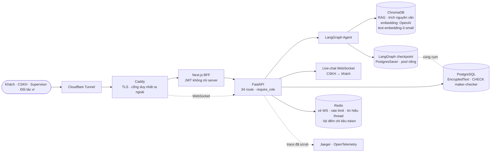
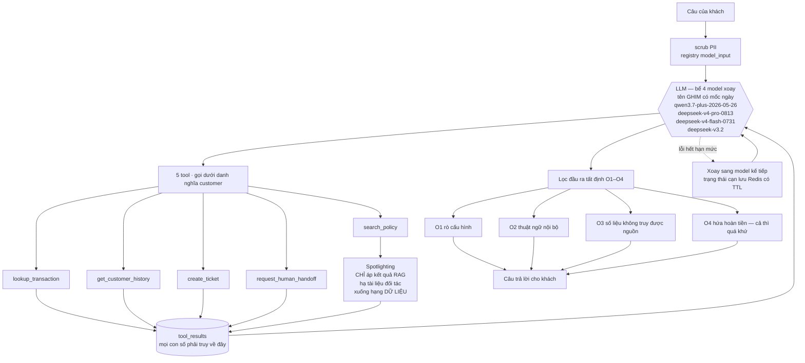
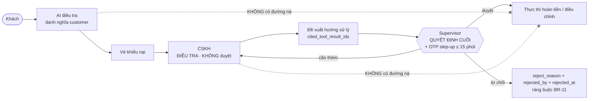

# Kiến trúc hệ thống FIN-05

> **Đo lại 20/08/2026** từ `docker-compose.yml`, `contracts/`, `src/` và ngăn xếp đang chạy —
> không vẽ từ trí nhớ. Bản trước (16/08) ghi model là `GPT-4o-mini`, **đã sai** kể từ ADR-043.
>
> Mọi tên tool · tên route · tên trạng thái dưới đây là **nguồn sự thật trong `contracts/`**,
> và `tests/test_invariants.py` introspect app đang chạy để bắt lệch. Sơ đồ này mô tả, contract quyết định.

---

## 1. Thành phần hệ thống

**Bảy container** — `caddy` · `cloudflared` · `frontend` · `backend` · `postgres` · `redis` · `jaeger`.
Chỉ `caddy` publish ra ngoài; `postgres` và `jaeger` ghim `127.0.0.1`.

---

## 2. Một lượt của agent — nơi mọi ràng buộc được ép

**Ba điều sơ đồ này khẳng định, và đều có test bắt được nếu lệch:**

- 🔴 **Spotlighting KHÔNG nằm trên trục chính, và không áp lên câu của khách.** [ĐO]
  `danh_dau_du_lieu()` được gọi **đúng một chỗ trong toàn `src/`**: `customer_tools.py:409`, trên
  **kết quả `search_policy`** — tức nó chạy **SAU** khi LLM đã gọi tool ít nhất một lần. Việc của nó
  là **hạ tài liệu của đối tác ví xuống hạng DỮ LIỆU**, để nội dung trong đó không bao giờ được đọc
  như chỉ thị. Thứ bảo vệ câu của khách là `scrub_pii` (`graph.py:901`), một cơ chế khác.
  *(Bản sơ đồ 20/08 từng vẽ spotlighting trên trục chính giữa scrub-PII và LLM — **SAI**, vẽ theo
  trực giác kiến trúc chứ không theo code. Lead bắt được.)*
- **O1–O4 là regex tất định, độc lập với model.** Đổi model không làm lưới cuối yếu đi.
- 🔴 **Bể chỉ nhận TÊN GHIM có mốc ngày. Bí danh trôi (`deepseek-v4-pro`, `deepseek-v4-flash`) bị
  TỪ CHỐI lúc khởi động** — ADR-043 loại 2/5 model vì lý do này. Một cái tên không mốc có thể trỏ
  sang trọng số khác sau một đêm mà không ai biết.
- **Xoay model chỉ kích hoạt bởi lỗi hạng hết-hạn-mức** (`quota · exhaust · insufficient · balance · arrear · unpurchased`). **`429` không xoay** — nghẽn tạm thời không phải cạn hạn mức.
- **Chat và embedding chạy HAI nhà cung cấp khác nhau** — chat qua DashScope (bể 4 model), embedding
  qua OpenAI ([ĐO] `EMBEDDING_BASE_URL=None`). Tách cố ý: một bên cạn hạn mức không kéo bên kia chết theo.
- **Scrub PII dùng hai registry theo MỤC ĐÍCH.** Đường `model_input` cố ý bỏ SpacyRecognizer / DateRecognizer / PhoneRecognizer chung — chúng che nhầm mã giao dịch nội bộ. Đường `log` giữ nguyên over-redaction. Bóp méo câu tiếng Việt: **1,6% (2/124)**, có cổng `eval/do_bop_meo_pii.py` tự chấm lại.

---

## 3. HITL — nơi AI không có mặt

**Năm tool bị cấm tuyệt đối với AI** — `approve_resolution` · `execute_refund` · `adjust_balance` ·
`lock_wallet` · `escalate_to_supervisor`. Không tồn tại trong `build_customer_tools()`, và
`tests/test_invariants.py::test_inv08` gọi thẳng hàm đó để xác nhận.

**Maker–checker (BR-12):** người đề xuất không được là người duyệt. Ép ở tầng `CheckConstraint`
trong database, không chỉ ở tầng ứng dụng.

**Gắn cờ nghi gian lận ≠ khoá ví** — hai hành động độc lập hoàn toàn, không code nào nối trực tiếp.

---

## 4. Cơ chế giữ sơ đồ này khỏi trôi

Đây là phần khác biệt so với một sơ đồ kiến trúc thông thường: **cấu trúc hệ thống sống trong
`contracts/`, không sống trong tài liệu.**

| file | quy định |
|---|---|
| `contracts/authority-matrix.yaml` | 34 route × role nào được gọi |
| `contracts/agent-tools.yaml` | 5 tool được phép · 5 tool bị cấm · cơ chế truy vết |
| `contracts/resolution-state-machine.yaml` | vòng đời HITL · 3 trục trạng thái trực giao |

`tests/test_invariants.py` **introspect app đang chạy thật** — đọc `app.routes`, moi `allowed_roles`
từ closure của `require_role()`, đọc `CheckConstraint` qua AST, gọi thẳng `build_customer_tools()` —
rồi so với `contracts/`. Thêm một route · đổi một guard · đổi tên một tool mà quên cập nhật contract
⟹ **đỏ ngay**, không ai phải nhớ nhắc ai.

**Danh tính của vật đã dựng:** `src/dau_ma_nguon.py` băm nội dung mã nguồn và đóng dấu vào ảnh tại
`/app/.bam_ma_nguon`; `frontend/src/dau_ma_nguon.mjs` làm việc tương đương cho frontend. Đối chiếu
băm host với băm trong container trả lời được câu *"ảnh đang chạy có đúng mã nguồn này không"* trong
hai giây — `build_commit` **đã được chứng minh nói dối theo cả hai chiều**, nên không dùng.
