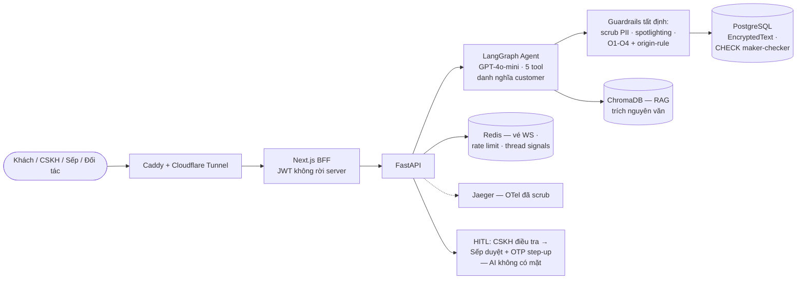

# Architecture Diagram — FIN-05

> Sơ đồ đầy đủ + data flow + bảng quyết định kiến trúc: **[ARCHITECTURE.md](../ARCHITECTURE.md)**
> (nguồn duy nhất, không nhân bản để tránh trôi). File này giữ bản rút gọn cho deliverable #3.

**Data flow một câu:** khách gõ → scrub PII → agent gọi tool thật → lọc đầu ra (số phải truy về
tool result) → khách; tiền chỉ đi khi Sếp mở hồ sơ đọc căn cứ và duyệt bằng OTP gắn đúng đề xuất —
ràng buộc người-tạo-≠-người-duyệt nằm ở tầng database.
