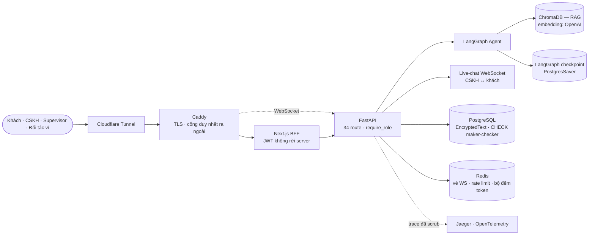
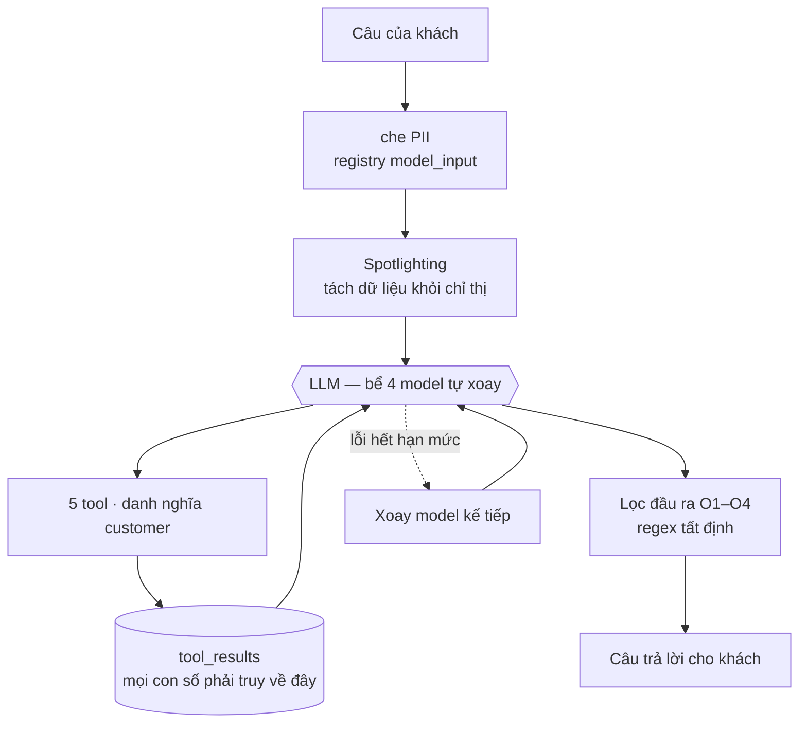
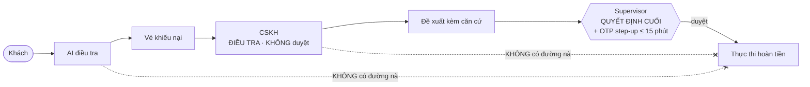

# PROJECT KNOWLEDGE — FIN-05 · Đội T226

> **Tài liệu này TỰ CHỨA.** Người đọc không cần truy cập mã nguồn — mọi dữ kiện, con số và sơ đồ
> cần thiết đều nằm trong đây.
>
> **Dùng để:** đưa vào Claude Desktop cùng `06-pitch-deck.md` để dựng slide thuyết trình.
>
> **Chốt số lúc 12:30 · 20/08/2026.** Mọi con số đo bằng lệnh trên repo, không lấy từ trí nhớ.
> Nếu bạn đọc tài liệu này sau ngày đó, hãy coi các số là **mốc đã niêm**, không phải trạng thái hiện tại.

---

## 1. Sản phẩm là gì — một đoạn

FIN-05 là **AI Agent hỗ trợ nhân viên CSKH ví điện tử xử lý khiếu nại giao dịch**. Khách chat mô tả
vấn đề; agent **điều tra** bằng công cụ tra cứu thật, phân loại khiếu nại, và đề xuất hướng xử lý
**có căn cứ truy vết được**. Agent **không bao giờ quyết định** — mọi hành động chạm tiền đều phải
qua người duyệt.

Câu định vị: **"Agent điều tra. Người quyết định. Mọi con số truy được về nguồn."**

**Bối cảnh:** AI 20K Build Phase, Cohort 3 (Vingroup × VinUni). PO & thực hiện: Đào Ngọc Bích.
Mentor: Đặng Hải Lộc. Đối tác nghiệp vụ: ZaloPay (góc nhìn nghiệp vụ thật, phản hồi demo).

---

## 2. Bài toán nghiệp vụ

Khách khiếu nại một giao dịch. CSKH phải tra đúng giao dịch **giữa nhiều giao dịch cùng số tiền,
cùng ngày**, đối chiếu chính sách, phân loại, rồi đề xuất hướng xử lý. Mỗi khiếu nại là một cuộc
điều tra thủ công.

**Taxonomy — 4 loại khiếu nại × 3 phạm vi giao dịch:**

| loại khiếu nại | phạm vi giao dịch |
|---|---|
| `double_charge` — bị trừ tiền hai lần | `internal_wallet` — ví ↔ ví nội bộ |
| `money_not_received` — người nhận chưa nhận được | `from_bank` — từ ngân hàng vào ví |
| `refund` — yêu cầu hoàn tiền | `to_bank` — từ ví ra ngân hàng |
| `wrong_recipient` — chuyển nhầm người | |

**4 role, quyền tách bạch:**

| role | được làm gì |
|---|---|
| `customer` | khách hàng — chat, tra cứu giao dịch của chính mình |
| `cskh` | **điều tra, KHÔNG duyệt** — màn hình của họ không có nút duyệt |
| `supervisor` | **quyết định cuối, mọi phạm vi** — kể cả nội bộ ví–ví |
| `partner_admin` | **chỉ** quản lý kho chính sách RAG, không chạm dữ liệu khách |

---

## 3. Năm ràng buộc cứng — xương sống của toàn bộ thiết kế

```
1. HITL TUYỆT ĐỐI       Không tồn tại đường đi nào cho AI hoặc CSKH tự thực thi
                        hoàn tiền / điều chỉnh số dư. Chỉ supervisor duyệt được.

2. AI KHÔNG VƯỢT CẤP    AI không có role riêng — nó gọi tool DƯỚI DANH NGHĨA
                        `customer`. Leo thang chỉ xảy ra qua tầng service hoặc
                        route của CSKH, không bao giờ do AI tự gọi.

3. CẤM BỊA SỐ LIỆU      Mọi số tiền / trạng thái / thời điểm agent nhắc tới phải
                        truy được về một kết quả tool có thật. Không tra được
                        → nói rõ "không tra được".

4. XÁC THỰC             OTP PHIÊN LÀM VIỆC, không phải OTP giao dịch. Không bao
                        giờ hỏi mật khẩu ví, không bao giờ hỏi OTP giao dịch.

5. GẮN CỜ ≠ KHOÁ VÍ     Gắn cờ nghi gian lận và khoá ví là hai hành động độc lập
                        hoàn toàn. Không code nào nối trực tiếp cái này sang cái kia.
```

🔴 **Điều khác biệt không phải việc viết ra năm ràng buộc — ai cũng viết được.** Là **cả năm được mã
hoá thành 23 test tự động**, và **test đỏ = build hỏng**. Không thể vi phạm mà build vẫn xanh.

---

## 4. Kiến trúc

### 4.1 Thành phần hệ thống — 7 container



Chỉ `caddy` mở ra ngoài. `postgres` và `jaeger` ghim `127.0.0.1`.

### 4.2 Một lượt của agent — nơi mọi ràng buộc được ép



**5 tool AI ĐƯỢC gọi:** `lookup_transaction` · `get_customer_history` · `create_ticket` ·
`request_human_handoff` · `search_policy`

**5 tool AI BỊ CẤM tuyệt đối:** `approve_resolution` · `execute_refund` · `adjust_balance` ·
`lock_wallet` · `escalate_to_supervisor`
*(không tồn tại trong hàm dựng tool; một test gọi thẳng hàm đó để xác nhận)*

**Bốn lớp lọc đầu ra, chạy trên câu trả lời trước khi tới khách:**

| | chặn gì |
|---|---|
| **O1** | rò cấu hình hệ thống |
| **O2** | thuật ngữ nội bộ |
| **O3** | số liệu không truy được về nguồn |
| **O4** | hứa hoàn tiền — **cả thì quá khứ** (*"đã hoàn tiền"*, *"vừa hoàn tiền"*) |

🔴 **O1–O4 là regex tất định, ĐỘC LẬP VỚI MODEL.** Đổi model không làm lưới cuối yếu đi — đây chính
là lý do hệ thống dám xoay model tự động.

### 4.3 HITL — nơi AI không có mặt



**Maker–checker:** người đề xuất không được là người duyệt — ép ở tầng `CheckConstraint` trong
**database**, không chỉ ở tầng ứng dụng.

### 4.4 Hạ tầng tự xoay model

Bể 4 model qua DashScope, **tên GHIM có mốc ngày**: `qwen3.7-plus-2026-05-26` · `deepseek-v4-pro-0813` · `deepseek-v4-flash-0731` · `deepseek-v3.2`.

🔴 **Bể CHỈ nhận tên ghim; bí danh trôi bị từ chối lúc khởi động.** ADR-043 loại 2/5 model được đề xuất vì tên không mốc (`deepseek-v4-pro`, `deepseek-v4-flash`) — một cái tên không mốc có thể trỏ sang trọng số khác sau một đêm mà không ai biết, và guardrail thì không phát hiện được điều đó.
Cạn hạn mức một model ⟹ hạ tầng tự chuyển, không ai phải sửa cấu hình lúc nửa đêm.

🔴 Xoay **chỉ** khi lỗi thuộc hạng hết-hạn-mức (`quota`, `exhaust`, `insufficient`, `balance`,
`arrear`, `unpurchased`). **`429` KHÔNG xoay** — nghẽn tạm thời không phải cạn hạn mức.

**Chat và embedding chạy hai nhà cung cấp khác nhau** — chat qua DashScope, embedding
(`text-embedding-3-small`) qua OpenAI. Tách cố ý: một bên cạn hạn mức không kéo bên kia chết theo.

---

## 5. Cơ chế làm cho tài liệu không thể nói dối

**Đây là điểm khác biệt kỹ thuật đáng kể nhất của dự án.**

Cấu trúc hệ thống **sống trong `contracts/`**, không sống trong code, không sống trong đầu ai:

| file contract | quy định |
|---|---|
| `authority-matrix.yaml` | 34 route × role nào được gọi |
| `agent-tools.yaml` | 5 tool được phép · 5 tool bị cấm · cơ chế truy vết |
| `resolution-state-machine.yaml` | vòng đời HITL · 3 trục trạng thái trực giao |

Bộ test **introspect chính ứng dụng đang chạy** — đọc bảng route thật, moi danh sách role được phép
ra **từ closure của hàm guard**, đọc ràng buộc database **qua cây cú pháp**, gọi thẳng hàm dựng tool
— rồi so với contract.

⟹ **Thêm một route · đổi một guard · đổi tên một tool mà quên cập nhật contract ⟹ ĐỎ NGAY.**
Không ai phải nhớ nhắc ai.

**Danh tính của vật đã dựng:** hệ thống băm **nội dung mã nguồn** và đóng dấu vào ảnh Docker, cho cả
backend lẫn frontend. Câu *"ảnh đang chạy có đúng mã nguồn này không"* trả lời trong hai giây. Cơ chế
này dựng sau khi **chứng minh được `build_commit` nói dối theo cả hai chiều**.

---

## 6. Số liệu — chốt 12:30 · 20/08/2026

```
985 commit trong 3 tuần        46 ADR có ghi lý do BÁC phương án khác
11 PR đã merge                 7 container
56 file Python · 67 file TS    34 route trong contract
90 file test backend           19 file E2E Playwright
14 bộ dữ liệu đánh giá         23 test ràng buộc cứng
```

**Ngưỡng chất lượng có cổng tự động canh:**

| trục | ngưỡng | đo được |
|---|---|---|
| Bịa số liệu | **= 0** | có cổng, đỏ được |
| AI/CSKH tự hoàn tiền | **= 0** | 23 test invariant |
| Timeout một lượt | **≤ 45 giây** | ghim đúng số |
| Vòng suy luận ReAct | **≤ 20** | ghim đúng số |
| OTP xem dữ liệu / hành động | **≤ 12 giờ / ≤ 15 phút** | test biên hai chiều |
| Bóp méo câu tiếng Việt | **≤ 6%** | **đo 1,6% (2/124 câu)** |

**Câu chuyện đằng sau số 1,6%:** bộ che PII ban đầu bóp méo **50,8%** câu tiếng Việt đời thường —
nuốt cả số tiền lẫn mã giao dịch, vì nó nhận nhầm `TXN20260810...` thành ngày tháng và dãy số bất kỳ
thành số điện thoại. Giải pháp: **tách hai đường xử lý theo MỤC ĐÍCH** — đường gửi cho model dùng bộ
nhận diện hẹp, đường ghi log giữ nguyên che rộng. Còn **1,6%**, và có cổng tự chấm lại.

**Bốn nhóm code-based eval — cả bốn đều có cổng đỏ được:**

| nhóm | có cổng | có số trên sản phẩm |
|---|---|---|
| Structure / Format | ✅ | ✅ |
| Presence / Coverage | ✅ | ⬜ chưa có bản ghi đủ tốt |
| Tool-call / Sequencing | ✅ | ✅ **0 vi phạm / 39 bản ghi** |
| Threshold checks | ✅ | ✅ |

---

## 7. 🔴 Điều CHƯA chứng minh được — phải nói ra, không giấu

**Đây là mục quan trọng nhất của tài liệu này. Đừng cắt khi làm slide.**

- **Điểm benchmark 87,7% là mốc đo ngày 16/08, KHÔNG phải điểm của bản đang chạy.** Sau ngày đó đã
  đổi model và thay đổi 4 vùng (RAG · bộ lọc · che PII · prompt).
- **87,7% loại trục Trải nghiệm (15 điểm) khỏi mẫu số** vì chưa hiệu chuẩn ⟹ **con số này không nói
  gì về việc khách có dễ chịu khi nói chuyện với bot không.** Một agent an toàn tuyệt đối nhưng trả
  lời cộc lốc như máy vẫn ra đúng 87,7%.
- **Trọng số 5 trục (30/25/20/15/10) là phán đoán chưa hiệu chuẩn**, không phải kết quả tính toán.
  Đảo hai trọng số bất kỳ mà kết luận không đổi ⟹ trọng số đang là trang trí.
- **Ngưỡng An toàn chưa phủ họ lỗi "bịa có vỏ bọc sau một câu từ chối đúng"** — dạng *"chưa tìm
  thấy… Tuy nhiên thông thường…"*.
- **Sản phẩm chưa deploy công khai** tại thời điểm chốt tài liệu này.

---

## 8. Cách đội vận hành — 1 người thật + nhiều phiên AI

| vai | vùng ghi |
|---|---|
| PO | `docs/`, tài liệu gốc repo |
| tech-lead | `src/`, `frontend/src/`, `contracts/` (sau khi PO duyệt) |
| tester | `tests/`, `eval/` — 🔴 **CỐ Ý bị chặn không cho đọc `src/`** |
| security | `docs/security/` |
| DevOps | `Dockerfile`, `docker-compose*.yml`, CI |
| critic | **không ghi gì**, chỉ tìm lý do thứ đang có là sai |

🔴 **Vì sao tester không được đọc mã nguồn:** cho tester đọc code thì test nó viết sẽ **phản chiếu
logic đang có — kể cả logic sai**. Kết quả là **một suite xanh mướt chứng minh rằng bug hoạt động
đúng như bug**.

Đây là **kiến trúc đối kháng**, không phải phân công cho gọn.

---

## 9. Kỷ luật đo lường — câu chuyện đáng kể nhất

**Ngày 20/08, đội bắt được 9 khẳng định sống lâu hơn sự thật của nó.**

Không phải chín lời nói dối — chín câu **từng đúng**, rồi thực tế đi qua mà sổ sách không đi theo:

| khẳng định | sự thật |
|---|---|
| *"Hai ca kiểm an toàn chưa chạy được"* | Sai từ 5 ngày trước — chúng đã chạy và **đạt** |
| *"Bóp méo tiếng Việt 5,6%"* | Đo trên một chữ ký hàm **nay không còn tồn tại**; thật là **1,6%** |
| *"Chín file mang nhãn finding chưa vá"* | Thật ra **một**. Người đếm dùng tìm-chuỗi thay vì bộ lọc nhãn |

Cái thứ ba đáng kể nhất: phép đếm sai đã khớp trúng những câu ghi nguyên văn *"không còn nhãn này"*
và **đếm chính bằng chứng nhãn ĐÃ GỠ thành bằng chứng nhãn CÒN ĐÓ** — cho kết quả **ngược 180 độ**.

🔴 **Cả chín được niêm tại chỗ kèm bằng chứng, KHÔNG XOÁ** — xoá đi thì phiên sau phát hiện lại từ
đầu. Lỗi của người điều phối được **ghi tên**, vì một luật rút từ lỗi cấp trên mà giấu tên thì lần
sau ai cũng tưởng nó chỉ áp cho cấp dưới.

---

## 10. Diễn tập deploy — 6 chỗ đứt không đọc tài liệu ra được

Trước khi lên production, đội dựng lại sản phẩm **từ một bản clone sạch**, đóng vai người lần đầu
tiếp cận. Tìm ra **6 chỗ đứt**, và **không chỗ nào phát hiện được bằng cách đọc lại tài liệu** — vì
người viết tài liệu không thể tự thấy thứ máy mình đã có sẵn.

| | người deploy sẽ thấy gì | nguyên nhân thật |
|---|---|---|
| ① | không có file mẫu cấu hình để copy | nhánh chính thiếu 77 commit |
| ② | *"hãy chạy trong container"* — với người **đang** ở trong container | một thông báo lỗi phục vụ hai nguyên nhân |
| ③ | script nạp dữ liệu chết | thiếu một tệp cố ý không commit, không bước nào nói phải sinh trước |
| ④ | script nạp dữ liệu chết giữa chừng | 5 khối cuối **chưa từng chạy lần nào** |
| ⑤ | 🔴 lệnh kiểm tra sức khoẻ báo **XANH** | **xanh cả khi backend đã chết** |
| ⑥ | 🔴 **không triệu chứng nào cả** | một biến môi trường thiếu ⟹ mở toàn bộ tài liệu API ra Internet |

**Hai chỗ cuối nguy hiểm hơn bốn chỗ đầu cộng lại:** bốn chỗ đầu **chặn người deploy lại**; hai chỗ
cuối **để họ đi tiếp với một niềm tin sai**.

---

## 11. Gợi ý mạch kể khi lên slide

Ba nhịp, và **nhịp ba mới là nhịp thuyết phục**:

1. **Ràng buộc quyết định kiến trúc** — trong ví điện tử, "đoán cho êm tai" là sự cố, không phải trải
   nghiệm kém. Từ đó ra 5 ràng buộc cứng.
2. **Ràng buộc được ép bằng máy, không bằng lời hứa** — contract + test introspect app đang chạy;
   guardrail tất định độc lập với model.
3. **Đội đo được chính mình** — 9 lần bắt được khẳng định đã chết trong một ngày, niêm lại không xoá,
   ghi tên cả lỗi của người điều phối. **Một đội đọc được giới hạn của con số mình đưa là một đội
   dùng được con số đó.**

**Ba câu đắt nhất, dùng nguyên văn:**

> *"Agent điều tra. Người quyết định. Mọi con số truy được về nguồn."*

> *"Chúng tôi không xây một con bot trả lời hay. Chúng tôi xây một hệ thống mà khi nó sai, ta biết
> ngay và biết vì sao."*

> *"Màn hình CSKH không có nút duyệt. Đó không phải thiếu tính năng — đó là ràng buộc cứng số 1."*

**Gợi ý hình ảnh:** ba sơ đồ mermaid ở mục 4 render thẳng được. Bảng "6 chỗ đứt" và bảng
"9 khẳng định" nên để **nguyên dạng bảng** — sức nặng của chúng nằm ở việc **đọc được từng dòng**,
không nằm ở việc tóm tắt.

**Tông:** kỹ thuật, điềm tĩnh, không cường điệu. Điểm mạnh của dự án này là **sự trung thực có kỷ
luật** — làm slide hoa mỹ sẽ phá đúng thứ đang thuyết phục nhất.


---

## ⚠️ KIỂM TAY TRƯỚC KHI NỘP — file này nằm NGOÀI cơ chế tự canh

`gate/MANIFEST.md` ghi băm sha256 để phát hiện bản sao đã trôi. **File này không có bản gốc nơi
khác, nên nó KHÔNG nằm trong bảng băm đó** — không cơ chế nào báo khi nó nói sai.

Ba thứ đối chiếu tay, mất một phút:
```bash
grep LLM_MODEL_POOL .env                          # tên model — phải KHỚP, kể cả mốc ngày
grep -c '^## ADR-' docs/DECISIONS.md              # số ADR
git log --format='%ad' --date=format:'%Y-W%V' | sort | uniq -c   # số commit mỗi tuần
```
🔴 **Ca thật 20/08:** ba file trong `gate/` từng ghi bể model là `deepseek-v4-pro` / `deepseek-v4-flash`
— **đúng hai bí danh mà ADR-043, nằm chung hồ sơ, đã tường minh TỪ CHỐI vì không có mốc ngày.** Hồ sơ
tự mâu thuẫn ngay trên chủ đề nó dùng làm điểm nhấn. Review bắt được; không cơ chế nào bắt được.
